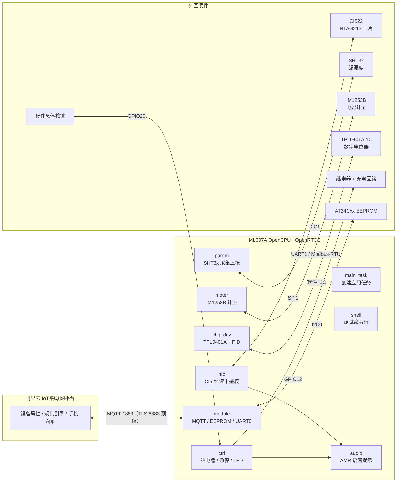
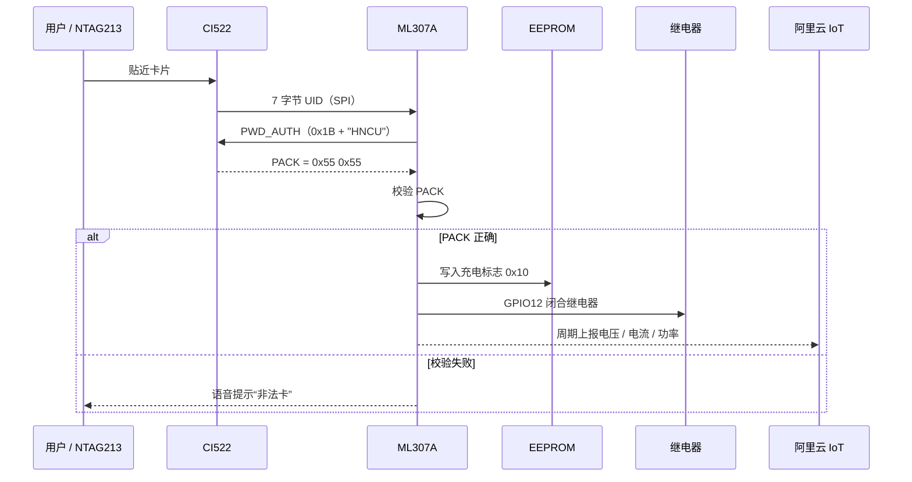

# 智能无感充电测控系统 · ML307A OpenCPU

**Smart Contactless E-Bike Charging Controller** — 基于中移物联网 ML307A OpenCPU 的单芯片电动自行车充电控制器


> **English overview**
> A 4G Cat.1 e-bike charging controller running entirely on the China Mobile **ML307A OpenCPU** module — no external MCU. It integrates **CI522 + NTAG213** tap-to-charge authentication (PWD_AUTH/PACK), **IM1253B** Modbus-RTU metering, **SHT3x** temperature/humidity sensing, **TPL0401A** digital-potentiometer power regulation, relay control with a hardware emergency stop and EEPROM power-loss resume, **MQTT / Alibaba Cloud IoT** reporting, local **AMR voice prompts**, and a UART debug shell — organized as seven OpenRTOS tasks.
>
> **Keywords**: OpenCPU · Cat.1 · RTOS · MQTT · Alibaba Cloud IoT · RFID · NTAG213 · Modbus-RTU · PID · I²C / SPI / UART

> 本仓库基于中移物联网 ML307A OpenCPU SDK 1.4.6 二次开发。原厂 SDK 说明已保留至 [`docs/SDK_README.md`](docs/SDK_README.md)，开发过程记录见 [`opencpu_readme.txt`](opencpu_readme.txt)。

---

## 目录

- [项目简介](#项目简介)
- [功能特性](#功能特性)
- [系统架构](#系统架构)
- [硬件设计](#硬件设计)
- [目录结构](#目录结构)
- [快速开始](#快速开始)
- [云端配置与通信协议](#云端配置与通信协议)
- [刷卡鉴权流程](#刷卡鉴权流程)
- [功率调节与安全保护](#功率调节与安全保护)
- [调试命令](#调试命令)
- [已知问题与改进计划](#已知问题与改进计划)
- [版权与致谢](#版权与致谢)

---

## 项目简介

面向电动自行车充电场景，常见方案采用「MCU + 4G 模组」双芯片架构：MCU 负责读卡、计量、控制，4G 模组负责上云，二者通过串口交互。本项目把业务逻辑直接运行在 **ML307A OpenCPU** 模组内部（Cat.1 + OpenRTOS），用一颗芯片完成：

- 13.56 MHz RFID 刷卡鉴权
- 电能计量与充电功率调节
- 继电器通断、硬件急停、掉电恢复
- 阿里云 IoT 远程测控与数据上报
- 本地语音提示与调试命令行

相比双芯片方案，硬件连接更简单、BOM 更少、开发链路更短，同时保留了 RTOS 下的多任务与队列解耦能力。

---

## 功能特性

- **单芯片架构**：业务代码运行于 ML307A OpenCPU 内置 OpenRTOS，7 个应用任务通过消息队列与标志位协作，无外置 MCU。
- **无感刷卡充电**：CI522（SPI）读取 7 字节 UID，NTAG213 `PWD_AUTH` 密码认证（`0x1B`）并校验 PACK；读卡芯片每 10 s 软复位，避免长时间运行后 SPI/天线异常。
- **计量与功率调节**：IM1253B 单相电能计量模块（Modbus-RTU，UART）；TPL0401A-10 数字电位器（软件 I²C，128 抽头）调节功率级；支持云端功率档位（0–100）与抽头直控（0–127）。
- **云端测控**：阿里云 IoT MQTT 接入，订阅属性设置、上报电压/电流/功率/温度/湿度；使用 cJSON 解析下行报文；传感器数据以 QoS 0 发布，QoS 2 状态上报函数已预留。
- **安全与可靠性**：硬件急停按键 200 ms 轮询，触发后立即断开继电器；EEPROM 保存充电标志，异常掉电重启后可恢复充电；温度/电量数据配合云端规则引擎做告警；SPI/I²C 失败自动重新初始化。
- **人机交互**：模块内置音频播放 AMR 提示音（上线、启动成功、非法卡等）；UART0 调试 shell 支持开关充电、模拟报警、打印传感器数据；LED 指示云端在线状态。
- **驱动封装**：硬件 I²C / SPI / UART 与软件 I²C 并存；UART 采用「事件回调 + 收发任务 + 队列」封装；IM1253B 使用标准 Modbus CRC16 校验。

---

## 系统架构



### RTOS 任务划分

任务表定义于 `custom/custom_main/src/custom_main.c` 的 `gTaskList[]`，由 `main_task` 统一创建：

| 任务 | 优先级 | 栈 | 主要职责 |
| --- | --- | --- | --- |
| `module` | Normal | 6 KB | MQTT 连接与收发、cJSON 解析、EEPROM 读写、UART0 调试串口 |
| `shell` | Normal | 4 KB | 解析 UART0 命令行并分发到各调试函数 |
| `nfc` | AboveNormal | 2 KB | CI522 初始化、寻卡/防冲撞/选卡、PWD_AUTH、10 s 周期复位 |
| `param` | Normal | 2 KB | SHT3x 周期采集，失败自动重开 I²C |
| `ctrl` | Normal | 2 KB | 继电器控制、LED、急停检测、电平转换使能 |
| `meter` | Normal | 2 KB | IM1253B Modbus 抄读、数据换算与上报 |
| `audio` | Normal | 4 KB | 按标志位播放 AMR 提示音 |
| `wdt` | — | — | 看门狗任务预留，当前未创建 |
| `main_task` | AboveNormal | 4 KB | 创建上述任务并让出 CPU |

任务间通过 `OSMqttMess` / `OSmeterMess` / `OSUartMess` 三个消息队列解耦：采集任务只负责入队，`module` 任务统一出队并发布到云端，避免多任务同时操作 MQTT 客户端。

---

## 硬件设计

| 功能 | 器件 | 接口 / 引脚 | 说明 |
| --- | --- | --- | --- |
| 主控与 4G 通信 | 中移 ML307A | — | Cat.1 模组，OpenCPU 内置 OpenRTOS |
| RFID 读卡 | CI522 | SPI1（PIN 30–33）、RST GPIO8、IRQ GPIO1 | 13.56 MHz，寄存器与 MFRC522/RC522 兼容 |
| 卡片 | NTAG213 | — | 7 字节 UID + 4 字节密码 + 2 字节 PACK |
| 电能计量 | IM1253B | UART1，9600 8N1 | Modbus-RTU 从机地址 0x01，功能码 0x03 |
| 温湿度 | SHT3x | I²C1，地址 0x44 | 周期模式，高重复性 |
| 功率调节 | TPL0401A-10 | 软件 I²C：GPIO6（SCL）/ GPIO7（SDA） | 128 抽头，10 kΩ，78.125 Ω/step |
| 参数存储 | AT24Cxx EEPROM | I²C0，地址 0x50 | 16 位地址访问，0x0000 保存充电标志 |
| 电平转换 | TXS0108E | 使能/复位 GPIO16、GPIO14 | 模块 IO 与 3.3 V 外设之间的 1.8 V/3.3 V 匹配 |
| 充电通断 | 继电器 | GPIO12 | 高电平闭合，低电平断开 |
| 紧急停止 | 按键 | GPIO20，上拉输入，低有效 | 200 ms 轮询，触发即断继电器 |
| 状态指示 | LED | GPIO0 | 云端在线时闪烁，离线熄灭 |
| 语音提示 | 模组内置音频 | `cm_audio_player` | AMR-NB 数据流播放 |

> 引脚编号为 ML307A 模组侧 IO / IOMUX 编号，实际接线需结合载板原理图调整；未使用的 PWM 通道初始化代码保留在 `chg_ctrl.c` 中。

### 硬件设计要点

- **电平匹配**：ML307A 模块侧 IO 与外设 3.3 V 逻辑不同域，使用 TXS0108E 双向电平转换；其驱动能力有限，只接继电器与读卡芯片，并为继电器控制线增加上拉电阻以增强驱动。
- **继电器反向电动势**：继电器线圈并联续流二极管，控制线远离 SPI 时钟与天线区域，避免吸合瞬间干扰读卡与 I²C 通信。
- **供电与接地**：充电功率回路与控制器电源分开走线，单点共地；读卡天线远离继电器与功率电感。
- **安全兜底**：急停目前为软件轮询。若面向商用，建议增加硬件断电回路（急停直接切断继电器线圈电源），软件轮询作为第二重保护。

---

## 目录结构

```text
opencpu/
├── ML307A_build.bat          # SDK 编译入口（另含 ML305A_build.bat）
├── ML307A_build.txt          # 编译命令示例
├── cmd.bat                   # 打开工程目录的快捷脚本
├── custom/
│   └── custom_main/          # ★ 应用代码
│       ├── inc/custom_main.h # 任务 ID、优先级、栈配置
│       ├── src/              # 业务与驱动源码
│       ├── custom_main.mk    # 源文件/头文件路径
│       └── sys_package.a     # 预编译应用包
├── docs/
│   ├── ML305A_ML307A_OpenCPU_API手册.chm
│   └── SDK_README.md         # 原厂 SDK 说明（由根目录 README 归档）
├── examples/                 # 原厂示例：aliyun、mqtt、spi、i2c、uart 等
├── include/                  # OpenCPU API 头文件（cmiot / platform）
├── prebuild/                 # 预编译库、链接脚本
├── src/cm_lib/               # SDK 组件源码（modem、ftp、tts 等）
├── third-party/              # cJSON、aliyun、zbar 等第三方库
├── opencpu_readme.txt        # 开发日志
├── tools/                    # ✗ 本仓库未包含，需从官方 SDK 补齐
└── out/                      # 编译输出（构建时生成）
```

### 应用源码说明

| 文件 | 职责 |
| --- | --- |
| `custom_main.c` | 程序入口 `cm_opencpu_entry()`，定义并创建全部 RTOS 任务 |
| `custom_main.h` | 任务 ID、优先级、栈大小与任务表结构体 |
| `chg_module.c/.h` | MQTT 客户端、主题与回调、cJSON、消息队列、EEPROM、UART0 |
| `chg_nfc.c/.h` | CI522 寄存器驱动、寻卡/防冲撞/选卡、PWD_AUTH、UID 白名单 |
| `chg_param.c/.h` | SHT3x 初始化、周期采集、I²C 异常恢复 |
| `chg_meter.c/.h` | IM1253B Modbus 请求、CRC16、电压/电流/功率/电能解析 |
| `chg_ctrl.c/.h` | 继电器、LED、急停、电平转换使能、控制任务 |
| `chg_dev.c/.h` | 软件 I²C、TPL0401A 读写、位置式 PID |
| `chg_audio.c/.h` | 内置 AMR 提示音播放 |
| `shell_task.c/.h` | 调试 shell 命令注册与执行 |
| `uart.c/.h` | UART 事件回调、收发任务与队列封装 |
| `chg_struct.h` | 全局标志位与跨任务共享变量 |

---

## 快速开始

### 1. 环境准备

- Windows 10/11，官方 ML307A OpenCPU SDK 1.4.6（`ML305A_ML307A_OpenCPU_Standard_1.4.6.x`）
- 交叉编译工具链、`make`、打包脚本（位于 SDK 的 `tools/` 目录）
- ML307A 开发板 / 目标板、USB 下载工具、串口助手

> ⚠️ **本仓库未包含 `tools/` 目录**（工具链、`tools/scripts/Makefile` 等），直接执行编译脚本会失败。请从官方 SDK 中复制完整的 `tools/` 到仓库根目录后再编译；该目录体积较大，也可仅保留在本地、不提交到 Git。

> ⚠️ **SDK 编译路径不能包含中文或空格**（构建脚本注释中已说明）。请将仓库放在例如 `D:\work\ml307a-opencpu` 这类纯英文路径下，`F:\简历\...` 会编译失败。

### 2. 编译

```bat
:: 4 MB Flash，无 GNSS
ML307A_build.bat DCLN

:: 8 MB Flash，无 GNSS
ML307A_build.bat DSLN

:: 4 MB Flash，带 GNSS
ML307A_build.bat GCLN

:: 8 MB Flash，带 GNSS
ML307A_build.bat GSLN

:: 清除编译产物
ML307A_build.bat CLEAN
```

编译产物输出到 `out/images/ML307A/`，使用中移物联提供的下载工具烧录。应用工程由 `custom/custom_main/custom_main.mk` 指定源文件，新增 `.c` 时需要同步加入 `OC_FILES`。

### 3. 云端配置

1. 在阿里云 IoT 平台创建产品（联网方式：蜂窝，数据格式：Alibaba Cloud JSON）与设备，获取 **ProductKey / DeviceName / DeviceSecret**。
2. 按[物模型属性](#物模型属性)中的标识符定义物模型属性。
3. 将 Broker 地址、ClientID、用户名、密码、Topic 填入 `custom/custom_main/src/chg_module.c` 的 MQTT 配置区。
4. 重新编译并烧录；设备上线后串口打印 `device_tn_open`，LED 开始闪烁。

> ⚠️ **不要把真实三元组与 MQTT 密码提交到公开仓库**。建议使用占位符或本地配置文件，并对已经提交过的密钥立即轮换。

### 4. 运行

上电后主任务先创建消息队列与各应用任务，`module` 任务随后初始化 EEPROM 与 MQTT 连接。串口 0（115200 8N1）打印启动信息与 shell 提示符 `sh>`。

---

## 云端配置与通信协议

### Topic

| 方向 | Topic | 说明 |
| --- | --- | --- |
| 下行 | `/sys/{ProductKey}/{DeviceName}/thing/service/property/set` | 云端下发属性设置 |
| 上行 | `/sys/{ProductKey}/{DeviceName}/thing/event/property/post` | 设备属性上报 |

### 连接参数

```text
Broker   : {ProductKey}.iot-as-mqtt.cn-shanghai.aliyuncs.com:1883
ClientID : {ProductKey}.{DeviceName}|securemode=2,signmethod=hmacsha256,timestamp={ts}|
Username : {DeviceName}&{ProductKey}
Password : HMAC-SHA256(DeviceSecret, ...)  // 由阿里云 IoT 三元组生成
KeepAlive: 60 s
```

> 代码中 `cm_ssl.h` 已引入，8883/TLS 相关初始化被注释保留；当前固件使用 1883 明文端口，TLS 启用项见[改进计划](#已知问题与改进计划)。

### 物模型属性

| 标识符 | 方向 | 类型 | 范围 / 单位 | 说明 |
| --- | --- | --- | --- | --- |
| `WorkSwitch` | 下行 | int | 0 / 1 | 0 停止充电，1 启动充电；同时写入 EEPROM 标志 |
| `power_ctrl` | 下行 | int | 0–100 | 功率档位，映射为数字电位器抽头 127 → 97 |
| `ctrlpower` | 下行 | int | 0–127 | 直接设置数字电位器抽头，用于标定/调试 |
| `voltage` | 上行 | float | V | 充电电压；充电中上报实测值，未充电上报 0 |
| `current` | 上行 | float | mA | 充电电流；充电中上报实测值，未充电上报 0 |
| `power` | 上行 | float | mW | 功率，由电压 × 电流计算；未充电上报 0 |
| `temperature` | 上行 | float | °C | SHT3x 温度 |
| `Humidity` | 上行 | float | %RH | SHT3x 湿度（字段首字母大写，需与 TSL 一致） |

下行报文示例：

```json
{"method":"thing.service.property.set","id":"","params":{"WorkSwitch":1},"version":"1.0.0"}
{"method":"thing.service.property.set","id":"","params":{"power_ctrl":60},"version":"1.0.0"}
```

上行报文示例：

```json
{"params":{"voltage":48.2,"current":1200.0,"power":57840.0}}
{"params":{"temperature":26.5,"Humidity":48.0}}
```

> `voltage` / `current` / `power` 由 `meter` 任务入队、`module` 任务发布；`temperature` / `Humidity` 由 `param` 任务发布。云端未在线时数据不会入队，避免无效发布。

---

## 刷卡鉴权流程



**实现细节**

- 寻卡使用 `PICC_REQALL`（`0x52`），通过 1 级/2 级防冲撞（`0x93` / `0x95`）拼接 7 字节 UID。
- 选卡后发送 `PWD_AUTH`（`0x1B`）+ 4 字节密码 + CRC16；NTAG213 返回 2 字节 PACK。
- 当前以 **PACK == 0x55 0x55** 作为合法卡判据；`white_list_search()` 已实现（30 条、14 字符十六进制、顺序查找），但尚未接入 `funCallBack()`，接入后即可实现「密码 + UID 白名单」双因子鉴权。
- 卡片需要预先个性化：将密码设为 ASCII `HNCU`（`0x48 0x4E 0x43 0x55`）、PACK 设为 `0x55 0x55`，并正确配置 `AUTH0` 保护起始页。建议量产时更换密码并在固件中改为分散密钥。
- 合法卡：启动充电、播放提示音、写入 EEPROM；非法卡：仅播放提示音，不动作。
- `nfc` 任务每 200 ms 读卡一次，每 10 s 关闭并重新初始化 SPI 与 CI522，用于恢复现场干扰导致的读卡死锁。

---

## 功率调节与安全保护

### 数字电位器

TPL0401A-10 通过软件 I²C（GPIO6/GPIO7）访问，写地址 `0x5C`、读地址 `0x5D`。抽头 `Step` 与两端电阻关系：

```text
RWH = (128 - Step) × 78.125 Ω
RWL = Step × 78.125 Ω
```

云端 `power_ctrl`（0–100）映射为抽头：

```c
step = 127 - (input * 30 / 100);   // 0 → 127，100 → 97
```

`ctrlpower` 则直接写入 0–127 的抽头值，便于标定。`chg_dev.c` 中实现了位置式 PID 框架；当前 `handle_work_power()` 使用上面的线性映射，PID 路径保留待参数修正与闭环标定后启用。

### 安全与恢复机制

| 机制 | 实现 | 行为 |
| --- | --- | --- |
| 硬件急停 | GPIO20 低有效，`ctrl` 任务 200 ms 轮询 | 立即断开继电器、清 EEPROM 标志、播放提示音 |
| 掉电续充 | EEPROM 地址 `0x0000` 保存 `0x10` | 启动时读到 `0x10` 则自动恢复充电并再次置位 |
| 停止充电 | 云端 `WorkSwitch=0` 或 shell 命令 | 断开继电器、清标志、语音提示 |
| 过温 / 过流告警 | 上报温度与电流，云端规则引擎判断 | 可配合 App 推送；`shell test temp/humi` 可模拟 60 °C / 90 %RH 验证规则 |
| 通信异常恢复 | SHT3x 连续读取失败重开 I²C；CI522 周期复位 | 提高长期运行稳定性 |
| 在线指示 | MQTT CONNACK 置位 `chg_mqtt` | LED 闪烁，离线熄灭 |

> 设备端目前没有独立的过温/过流阈值切断逻辑，告警依赖云端规则；急停为软件轮询。若用于真实充电场景，建议增加硬件比较器或独立保护电路作为本地兜底。

---

## 调试命令

UART0：**115200 8N1**，上电后输出 `sh>` 提示符。

| 命令 | 作用 |
| --- | --- |
| `reboot sw` / `reboot hw` | 软件重启 / 硬件重启 |
| `ctrl dev <0-127>` | 直接设置数字电位器抽头并打印 RWH/RWL |
| `ctrl config` | 打印当前电位器理论电阻值 |
| `param open` / `param close` | 打开 / 关闭温湿度周期打印 |
| `meter open` / `meter close` | 打开 / 关闭计量数据打印 |
| `nfc reboot` | 复位 CI522 读卡芯片 |
| `chg open` / `chg close` | 通过 shell 启动 / 停止充电（同时读写 EEPROM 标志） |
| `chg read` | 读取 EEPROM 中的充电标志 |
| `test temp` / `test humi` / `test close` | 模拟 60 °C / 90 %RH 报警测试 / 关闭模拟 |

命令注册于 `shell_task.c` 的 `shell_cmd_list[]`；新增命令时需同步添加回调与帮助字符串。

---

## 已知问题与改进计划

| 类别 | 当前状态 | 建议 |
| --- | --- | --- |
| 构建完整性 | 仓库缺少 `tools/` 工具链目录，无法直接编译 | 从官方 SDK 1.4.6 补齐 `tools/`，或在 README 中固定 SDK 版本与获取方式 |
| 密钥管理 | 云端三元组、MQTT 密码硬编码在 `chg_module.c` | 立即轮换已提交的密钥；改用本地配置/编译宏，仓库中只保留占位符 |
| 传输安全 | MQTT 使用 1883 明文，`cm_ssl` 初始化被注释 | 启用 8883 + TLS，校验服务器证书 |
| 功率闭环 | PID 框架已实现，但参数为 `uint16_t`（`Kp = 0.3` 会被截断为 0）；当前使用线性映射 | 参数改为 float，完成 IM1253B 反馈的闭环标定，加入积分限幅与死区 |
| UID 白名单 | 检索函数与白名单已实现，尚未接入鉴权 | 在 `funCallBack()` 中调用 `white_list_search()`，实现双因子 |
| 定时充电 | 未实现设备端定时策略 | 增加 RTC/本地定时器，或使用云端定时任务下发 `WorkSwitch` |
| 本地保护 | 过温/过流依赖云端规则与软件急停 | 增加本地阈值切断与硬件急停回路 |
| 看门狗 | `wdt` 任务仅预留 | 创建看门狗任务并在各任务中喂狗 |
| 计量精度 | 电压/电流换算系数按经验值写死 | 依据 IM1253B 手册与实测校准，增加功率因数、电能累计上报 |
| 工程规范 | 无 `.gitignore`，`out/`、预编译文件与密钥易被提交；无 LICENSE | 添加 `.gitignore`（`out/`、`*.bin`、`tools/`）与明确许可证 |

### Roadmap

- [ ] 接入 UID 白名单，完成「NTAG213 密码 + UID」双因子鉴权
- [ ] 启用 MQTT over TLS（8883）
- [ ] PID 闭环调参与功率标定
- [ ] 设备端定时充电与预约策略
- [ ] 本地过温/过流硬件保护
- [ ] 看门狗与异常日志
- [ ] 白名单/设备参数云端下发
- [ ] 补充原理图、接线图与演示视频

---

## 版权与致谢

- 本项目基于 **中移物联网 ML307A OpenCPU SDK 1.4.6** 开发。SDK、API 手册及 `include/`、`prebuild/`、`src/cm_lib/`、`tools/` 等目录的版权归中移物联网有限公司所有，使用须遵守原厂许可与相关法规；原厂说明见 [`docs/SDK_README.md`](docs/SDK_README.md)。
- `third-party/` 下的 cJSON、Aliyun SDK、zbar 等按其各自许可证分发。
- `custom/custom_main/` 下的应用层代码由项目作者编写，用于作品展示。仓库暂未声明开源许可证，如需引用或复用请联系作者。

**作者**：Yifan Huang（黄熠凡）· 物联网工程 · [GitHub @A-goldstar](https://github.com/A-goldstar)

> 本项目为学习与作品展示用途。涉及 220 V 交流充电回路的设计、调试与使用必须由具备资质的人员完成，并遵守当地电气安全规范。
